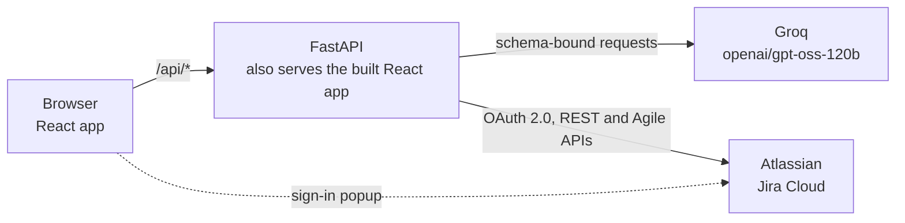

# ReqPrint

**Turn a plain-language project idea into a structured software requirements document, then into a Jira backlog.**

A personal project by [Layan Aljoudi](https://www.linkedin.com/in/layan-aljoudi/).

[live demo](LINK)

## Screenshots

_Screenshots to be added._

## Overview

Writing software requirements usually means hours of stakeholder interviews and
documentation before a single line of a spec exists. ReqPrint compresses that: describe
your project, or paste the notes you already have, answer a short adaptive interview, and
it generates a structured requirements document you can refine, review, export to Word, and
push into Jira as an epic, stories, and sprints.

## Features

- **Category step** — pick a project category (Software Systems, AI Solutions, FinTech,
  HR Tech, Productivity Tools, Other) so the questions suit the domain.
- **Describe or paste notes** — a plain description or raw meeting notes both work; notes
  are triaged into clear requirements, implied user stories, and open questions first.
- **Adaptive interview with suggested answers** — each question builds on the previous
  answer, comes with up to three suggested answers you can pick or override, and the
  interview ends after at most eight questions (or earlier, or when you skip ahead).
- **Document beside the conversation** — the generated document appears next to the
  conversation panel, which then becomes the place to ask for changes.
- **Five structured sections** — requirements (functional and non-functional), user
  stories, acceptance criteria (Given / When / Then), use cases, and assumptions.
- **Refine** — change any part of the document by describing the change in plain language.
- **AI review** — a second pass reads the document as a Business Analyst, a Developer, and a
  QA Tester, and flags what is ambiguous, missing, or untestable, with a severity (high,
  medium, low), why it matters, and a suggested fix.
- **Word export** — download the document as a `.docx`.
- **Jira integration** — connect your own Jira Cloud site with OAuth 2.0 and push the user
  stories into a new Scrum project: an epic, the stories in dependency order, and dated
  sprints sized from your team's weekly capacity. Optionally, each story is broken into
  sub-tasks derived from its acceptance criteria. Every push creates a new project; pushing
  into an existing one is not available in the interface.

## How it works

1. **Describe your idea, or paste your notes**, after choosing a category.
2. **Answer the clarifying questions** — a short, adaptive back-and-forth.
3. **Generate the document** — the five sections are built from the whole conversation.
4. **Refine, review, and export or push** — ask for changes, run the AI review, download
   the Word file, or push the stories to Jira.

## Architecture



One container serves both the API (under `/api`) and the built frontend (everything else),
so the browser only ever talks to one origin. The Jira connection is kept in an encrypted,
HttpOnly cookie; no token is stored on the server and there is no database.

## Tech stack

| Layer | Technology | Purpose |
| --- | --- | --- |
| Frontend | React 19, Vite, Tailwind CSS v4 | Single-page app: interview, document view, Jira dialogs |
| Backend | FastAPI, uvicorn | REST API under `/api`; serves the built frontend |
| AI | Groq, `openai/gpt-oss-120b` | Questions, generation, revision, review, notes triage, Jira ordering and sub-tasks |
| Validation | Pydantic | Strict JSON schema for every AI response; validation of request bodies |
| Rate limiting | slowapi | Daily limits per endpoint |
| Export | python-docx | Builds the `.docx` on the server |
| Jira | httpx, cryptography (Fernet) | Calls to Atlassian; encrypts the connection cookie |
| Packaging | Docker | One multi-stage image: Node build stage, Python runtime |
| Hosting | Render | Docker web service |
| Tests | `unittest`, Node test runner | Backend and frontend unit tests |

## Project structure

```
ReqPrint/
├── main.py              FastAPI app: routes, request models, rate limits, serves the frontend build
├── ai.py                Groq calls and the Pydantic schema for every AI response
├── prompts.py           System prompts for each AI stage
├── export.py            Builds the .docx
├── jira_oauth.py        Atlassian OAuth 2.0 and the encrypted connection cookie
├── jira_client.py       Calls to the Jira REST and Agile APIs
├── jira_push.py         The push: preflight, ordering, epic, stories, sprints, sub-tasks
├── sprint_plan.py       Sprint arithmetic (stories per sprint, sprint count, dates)
├── tests/               Python unit tests (Jira client, push, sprint math, ordering, sub-tasks)
├── frontend/            React app
│   ├── src/App.jsx          State, network calls, and which screen is shown
│   ├── src/components/      Landing page, workspace, document sections, Jira dialogs
│   ├── src/lib/             API client, Jira helpers, localStorage helpers, and their tests
│   └── src/dev/             Dev-only preview screens (not part of a production build)
├── Dockerfile           Multi-stage build (frontend, then Python runtime)
├── compose.yaml         Docker Compose service for the same image
├── requirements.txt     Python dependencies
├── .env.example         Environment variable names with placeholder values
├── README.Docker.md     Notes generated by Docker's tooling
├── .github/workflows/   Legacy AWS deploy workflow (no longer in use, see Deployment)
└── LICENSE              MIT
```

## API endpoints

All routes live under `/api`. Everything else is served from the built frontend.

| Method | Path | Description |
| --- | --- | --- |
| GET | `/api/health` | Liveness check |
| POST | `/api/extract-notes` | Triage pasted notes into requirements, implied stories, and open questions |
| POST | `/api/next-question` | Next clarifying question and suggested answers, or that the interview is done |
| POST | `/api/generate` | Generate the requirements document from the conversation |
| POST | `/api/revise` | Change the document from a plain-language instruction |
| POST | `/api/review` | Review the document from Business Analyst, Developer, and QA Tester perspectives |
| POST | `/api/export` | Build and return the document as a `.docx` |
| GET | `/api/jira/login` | Start the Atlassian OAuth flow (redirects to Atlassian) |
| GET | `/api/jira/callback` | OAuth callback; reports back to the app window and closes the popup |
| GET | `/api/jira/status` | Whether this browser has a Jira connection, and the site name |
| POST | `/api/jira/logout` | Forget the Jira connection |
| POST | `/api/jira/push` | Create the Jira project, epic, stories, sprints, and optional sub-tasks |

## Getting started

### Prerequisites

- A [Groq API key](https://console.groq.com/keys)
- An Atlassian OAuth 2.0 (3LO) app, because the server will not start without the Jira
  settings (see "Setting up Jira" below), even if you never use the Jira feature
- Docker, or Python 3.12+ and Node.js 20+ to run without it

### Environment variables

Copy `.env.example` to `.env` and fill in your own values. Names and placeholders only
here; never commit real values.

| Variable | Placeholder | Purpose |
| --- | --- | --- |
| `GROQ_API_KEY` | `your_key_here` | Groq API key; read by the backend only |
| `JIRA_CLIENT_ID` | `your_atlassian_client_id` | Atlassian app client ID |
| `JIRA_CLIENT_SECRET` | `your_atlassian_client_secret` | Atlassian app secret; backend only |
| `JIRA_REDIRECT_URI` | `http://localhost:8000/api/jira/callback` | OAuth callback; must match the one registered with Atlassian exactly |
| `FRONTEND_ORIGIN` | `http://localhost:8000` | Origin the app is served from (scheme, host, port; no path) |
| `SESSION_SECRET` | `generate_a_fernet_key` | Key that encrypts the Jira connection cookie |
| `APP_ENV` | `local` | `local` (http) or `prod` (https; cookies marked Secure) |

Generate a valid `SESSION_SECRET`:

```bash
python -c "from cryptography.fernet import Fernet; print(Fernet.generate_key().decode())"
```

Keep it stable: changing it makes every saved Jira connection unreadable.

### Setting up Jira

1. In the [Atlassian developer console](https://developer.atlassian.com/console/myapps/),
   create an **OAuth 2.0 integration**.
2. Under **Permissions**, add the **Jira API** and enable these 13 scopes:
   `read:jira-work`, `write:jira-work`, `read:jira-user`, `manage:jira-project`,
   `manage:jira-configuration`, `read:board-scope:jira-software`,
   `write:board-scope:jira-software`, `read:sprint:jira-software`,
   `write:sprint:jira-software`, `write:issue:jira-software`, `read:project:jira`,
   `read:issue-details:jira`, `read:jql:jira`. The app also asks for `offline_access` at
   sign-in (for refresh tokens); there is nothing to enable for it in the console.
3. Under **Authorization**, add your callback URL for OAuth 2.0 (3LO):
   `http://localhost:8000/api/jira/callback` locally, or your own `https://` origin
   followed by `/api/jira/callback`. It must equal `JIRA_REDIRECT_URI`.
4. Copy the client ID and secret into `.env`.

### Run with Docker

```bash
docker build -t reqprint .
docker run --env-file .env -p 8000:8000 reqprint
```

Open http://localhost:8000.

### Run without Docker

```bash
python -m venv .venv
source .venv/bin/activate
pip install -r requirements.txt

(cd frontend && npm install && npm run build)

uvicorn main:app --port 8000
```

Open http://localhost:8000. Use the built app on port 8000 rather than the Vite dev server
if you want to try Jira: the sign-in popup reports back to `FRONTEND_ORIGIN`. For frontend
work on the rest of the app, `npm run dev` in `frontend/` starts Vite and forwards `/api`
to the backend on port 8000.

### Run the tests

```bash
python -m unittest discover -s tests -t .
(cd frontend && npm test)
```

## Deployment

ReqPrint is deployed on Render as a Docker web service, built from the repository's
multi-stage `Dockerfile`, and it auto-deploys on every push to `main`. Configuration comes
from the same environment variables as above; in production, set `APP_ENV=prod` and use
`https://` values for `JIRA_REDIRECT_URI` and `FRONTEND_ORIGIN`, since the connection cookie
is only sent over HTTPS.

History: the app was originally deployed on AWS ECS and ECR with GitHub Actions and OIDC.
That workflow file (`.github/workflows/deploy.yml`) remains in the repository and is no
longer in use.

## Engineering notes

- **Schema-enforced AI output.** Every AI call is bound to a strict Pydantic JSON schema
  through Groq's structured outputs, so the shape of the document, the review, and the
  Jira plans is guaranteed rather than requested in a prompt and hoped for.
- **Interview, then generation.** Eliciting requirements and writing the document are
  separate AI stages with separate prompts, so the model is never interviewing and drafting
  at the same time.
- **Single-container build.** A Node stage compiles the frontend and the Python stage serves
  it together with the API from one process, so there is no separate frontend host and no
  cross-origin setup.
- **Per-endpoint rate limiting.** Each endpoint has its own daily limit (for example 2
  generations, 4 revisions, and 10 Jira pushes per client per day). A provider quota error
  from Groq is reported as a distinct "service busy" response rather than a generic failure.
- **Jira push without AI estimation.** The model only orders stories by dependency; sprint
  count is arithmetic from weekly capacity and sprint length. Sub-tasks must cite an
  acceptance criterion, which is enforced in code, and a failure part-way through is
  reported with Jira's own reason rather than rolled back.

## Roadmap

- **Compliance Check (planned, not implemented):** check the requirements against PDPL,
  ZATCA, INVEST, and EARS. The interface has a placeholder button that says the feature is
  in development; no checks exist yet.

## License

MIT. See [LICENSE](LICENSE).
